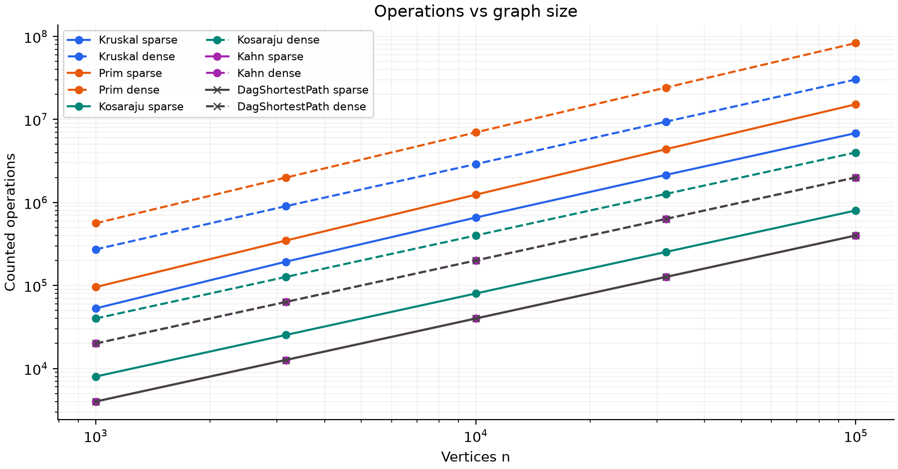
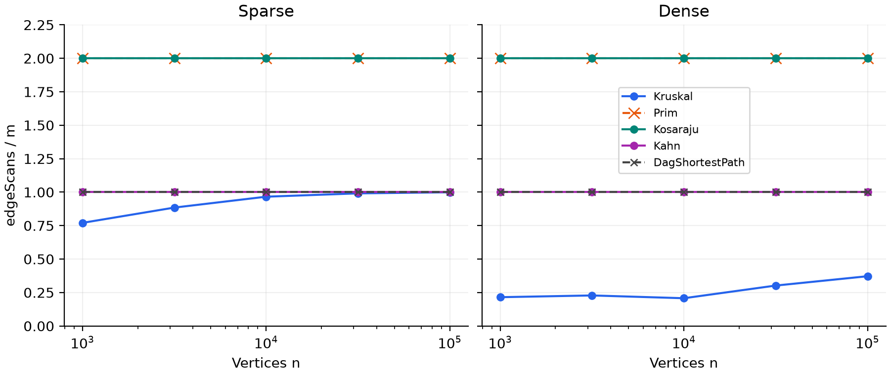
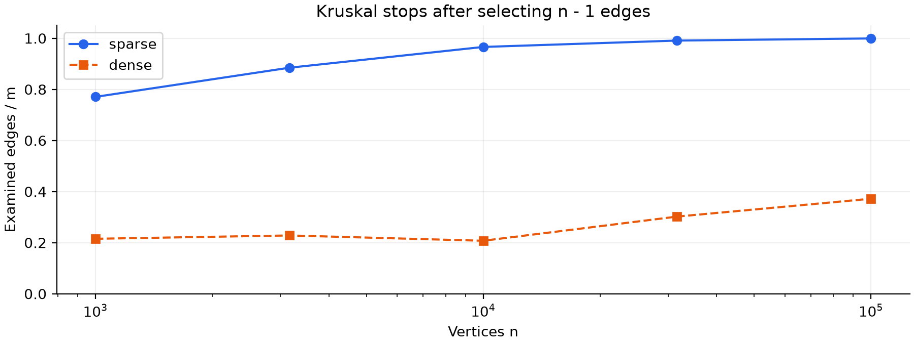

# Assignment 3: Graphs

Temirgaliyev Nurassyl | SE-2523 | Design and Analysis of Algorithms | 22 October 2026

## Implementation and measurement

One adjacency-list Graph class stores directed or undirected integer-weight edges. All six algorithms are implemented in Java. Distances and total weights use long. DSU uses union by size and full iterative path compression. Kosaraju uses explicit arrays as DFS stacks; no DFS is recursive. Prim begins at vertex 0 and restarts at each unvisited vertex to return a forest.

The benchmark uses a fresh Random(42) for each graph, the exact shuffle and generation order from the assignment, five sizes and two densities (m = 4n and 20n). Each size/density creates an undirected graph, a directed graph and a DAG: 30 inputs and 50 algorithm rows. Five measured runs per row give 250 runs. All reference values and required scan counts match. The detailed 50-row specification takes precedence over the final deliverables line mentioning four graphs.

### Complexity

| Operation | Time | Extra space | Reason |
| --- | --- | --- | --- |
| DSU find / union | O(alpha(V)) amortized | O(V) shared; O(1) per call | Size balancing limits height; compression flattens repeated paths. makeSet costs O(V). |
| Kruskal | O(V + E log(E+1) + E alpha(V)) | O(V + E) | Sort an edge-list copy, then perform at most E unions; DSU stores V entries. |
| Prim (lazy heap) | O(V + E log(E+1)) | O(V + E) | Scan adjacency lists; push/pop up to E edges. Parallel edges can enlarge the heap. |
| Kosaraju | O(V + E) | O(V + E) | Two DFS passes plus a transposed graph; explicit stacks are at most V deep. |
| Kahn | O(V + E) | O(V) | Copy maintained indegrees; enqueue each vertex once and inspect each edge once. |
| DAG shortest paths | O(V + E) | O(V) | Compute a topological order, then relax every outgoing edge once. |

### What the counters mean

Here alpha is the inverse Ackermann function. It grows so slowly that find and union have effectively constant amortized cost at practical input sizes. This is a bound over a sequence of operations, not a claim that every individual find takes exactly the same work.

dsuOps counts find calls plus successful unions, not parent-pointer steps. Kruskal calls union once per examined edge; union calls find twice, so dsuOps = 2 edgeScans + selectedEdges. Its comparisons count sorting weight comparisons. Prim comparisons count priority-queue weight comparisons; its scans count both adjacency entries of each undirected edge (2m).

Kosaraju records the two DFS scans (2m), excluding transpose construction. Kahn records m edge scans; indegrees are maintained during graph construction. DAG shortest paths records m relaxation scans, excluding its internal Kahn pass. These exclusions follow the required counter convention, although their work is included in measured time. maxDepth is the largest Kosaraju DFS frame stack; other rows use 0. Counters are stable across the five runs; library comparison counts can vary with a different sorting/heap implementation.

---

## Correctness and algorithm choice

### Cut property: Kruskal and Prim

Consider a cut that respects the forest already selected, so no selected edge crosses it. Let e be a lightest edge crossing the cut, and take a minimum spanning tree containing the selected forest. If that tree omits e, adding e creates a cycle with another crossing edge f. Since weight(e) is at most weight(f), replacing f by e preserves connectivity and cannot increase the total weight. Therefore the selected forest can safely include e, even when there are ties or negative weights. Kruskal applies this rule to a DSU component when considering the next sorted edge, while Prim applies it between visited and unvisited vertices; repeating independently in each connected component gives a minimum spanning forest.

### Induction on a topological order

Add a virtual source with zero-weight edges to every original vertex of indegree zero. Every vertex of a finite DAG is reachable from such a source, because repeatedly following predecessors must end without a cycle. Initially the source vertices have their correct distance zero. Assume all vertices earlier than v in topological order already have their correct shortest distances. Every predecessor of v occurs earlier, so all possible final edges into v have been relaxed and their minimum gives the correct distance to v. Induction therefore proves all distances after one pass; recording the predecessor on each improvement reconstructs a shortest path.

Negative edges are safe because a DAG has no cycle to repeat, and later vertices cannot feed back into settled earlier vertices. General graphs with negative edges need a method such as Bellman-Ford: a reachable negative cycle can make a finite shortest distance undefined. Negative weights also invalidate Dijkstra's usual guarantee, even without a negative cycle.

### Which algorithm when

| Situation | Choice | Why |
| --- | --- | --- |
| Many connectivity / merge queries | DSU | Almost-constant amortized queries; it does not find graph paths. |
| Sparse weighted undirected edge list | Kruskal | Sort the existing edges and use DSU to reject cycles. |
| Weighted undirected adjacency list | Prim | Grow from vertex 0 using the existing neighbors; restart for a forest. |
| Denser input, m = 20n, this implementation | Kruskal here | Measured comparisons are lower than lazy Prim. Both still have E log E bounds. |
| Truly dense simple graph, E near V squared | Consider O(V squared) array Prim | Avoid heap overhead; this alternative is not implemented here. |
| Directed graph; cycles may exist | Kosaraju | Find SCCs; size > 1 or a self-loop marks cyclic dependencies. |
| Need a job order or cycle detection | Kahn | Returns a valid order or reports a cycle. |
| Shortest routes in a DAG | DAG relaxation | Linear work and negative edges allowed; reject cyclic input. |

### Validation

All 23 JUnit 5 tests passed. DSU is checked against simple component labels; MST methods agree on 100 random connected graphs and return n - 1 edges. SCC partitions match BFS reachability in both directions, including n = 200. DAG distances and restored paths match Bellman-Ford with negative weights. Four file fixtures cover connected, disconnected, cyclic and DAG inputs. Extra checks cover empty graphs, self-loops, parallel edges, isolates, invalid input and a 100,000-vertex path whose explicit stack reaches 100,000 without JVM stack overflow.

---

## Verified results and normalized counters

Both MST algorithms agree in every run. Kahn returns n vertices with pos[u] < pos[v] for every edge. The table contains computed values, checked against the assignment's reference constants before the final CSV is replaced.

| n | m | MST weight | SCCs | Sum of DAG distances |
| --- | --- | --- | --- | --- |
| 1,000 | 4,000 | 147,970 | 27 | 396,274 |
| 1,000 | 20,000 | 30,363 | 1 | 252,411 |
| 3,162 | 12,648 | 468,911 | 137 | 1,271,911 |
| 3,162 | 63,240 | 97,589 | 1 | 723,157 |
| 10,000 | 40,000 | 1,486,139 | 373 | 3,941,828 |
| 10,000 | 200,000 | 309,550 | 1 | 2,381,342 |
| 31,623 | 126,492 | 4,715,515 | 1,188 | 12,551,891 |
| 31,623 | 632,460 | 968,517 | 1 | 7,376,612 |
| 100,000 | 400,000 | 15,012,094 | 3,923 | 40,096,539 |
| 100,000 | 2,000,000 | 3,056,681 | 1 | 23,512,087 |

### Counter / growth formula

| n | Density | Kruskal DSU / m | Kruskal cmp / m log2 m | Prim cmp / m log2 m | SCC scans / (n+m) | Kahn / DAG scans / (n+m) |
| --- | --- | --- | --- | --- | --- | --- |
| 1,000 | sparse | 1.791 | 0.891 | 1.829 | 1.600 | 0.800 |
| 1,000 | dense | 0.480 | 0.903 | 1.825 | 1.905 | 0.952 |
| 3,162 | sparse | 2.019 | 0.907 | 1.865 | 1.600 | 0.800 |
| 3,162 | dense | 0.506 | 0.846 | 1.847 | 1.905 | 0.952 |
| 10,000 | sparse | 2.182 | 0.869 | 1.895 | 1.600 | 0.800 |
| 10,000 | dense | 0.465 | 0.784 | 1.866 | 1.905 | 0.952 |
| 31,623 | sparse | 2.232 | 0.809 | 1.921 | 1.600 | 0.800 |
| 31,623 | dense | 0.654 | 0.720 | 1.878 | 1.905 | 0.952 |
| 100,000 | sparse | 2.248 | 0.745 | 1.934 | 1.600 | 0.800 |
| 100,000 | dense | 0.794 | 0.666 | 1.890 | 1.905 | 0.952 |

Each row's last column applies separately to Kahn and DAG relaxation. Prim scans/(n+m) equals the SCC column because both count 2m. Traversal ratios are exactly constant at a fixed density; heap and sorting ratios stay bounded and of similar scale. Kruskal DSU/m changes because the stopping position changes, but is at most 2 + (n-1)/m on these connected graphs. These measurements support the complexity bounds; finite data and call counts alone do not prove the inverse-Ackermann DSU bound.

The input weight range is only 1..1000, so many edges tie. Sorting all m edges is still required even when Kruskal's DSU loop stops early. Counts of comparisons, scans and DSU calls describe different work and must not be substituted for one another.

---

## Operations and fitted slopes

Operations = edge_scans + comparisons + dsu_ops. This is a transparent sum of counted events, not a claim that all events cost equal time. The Kahn and DAG lines coincide. Solid lines are sparse; dashed lines are dense.

| Algorithm | Density | Scan slope | Operation slope |
| --- | --- | --- | --- |
| Kruskal | sparse | 1.055 | 1.054 |
| Kruskal | dense | 1.119 | 1.022 |
| Prim | sparse | 1.000 | 1.101 |
| Prim | dense | 1.000 | 1.085 |
| Kosaraju | sparse | 1.000 | 1.000 |
| Kosaraju | dense | 1.000 | 1.000 |
| Kahn | sparse | 1.000 | 1.000 |
| Kahn | dense | 1.000 | 1.000 |
| DagShortestPath | sparse | 1.000 | 1.000 |
| DagShortestPath | dense | 1.000 | 1.000 |

Slopes use least-squares regression of log(counter) on log(n), fitted separately for each density across all five sizes. The logarithm base does not change the fitted slope. Prim, Kosaraju, Kahn and DAG edge scans have slope 1.000 because m is proportional to n and their counted scan multipliers are fixed.

Kruskal's scan slopes are slightly above 1 over this finite range because its examined fraction increases, not because scanning includes sorting. The handout associates the scan slope with E log E, but the logarithmic sorting factor belongs to comparisons. The operation slopes include those comparisons; fixed-range equal weights and early stopping can make finite fitted slopes differ from a worst-case asymptotic expectation.

---

## Scans, early stopping and timing

Prim and Kosaraju coincide at 2; Kahn and DAG relaxation coincide at 1. Their flat lines confirm linear counted edge work. Kruskal counts sorted edges only until its tree is complete, so its line is lower and varies with the graph.

Kruskal examines 77.0% to 99.9% of sparse edges and 21.5% to 37.2% of dense edges between the smallest and largest inputs. The denser graphs offer more inexpensive alternatives, so the tree is completed after a smaller fraction of the sorted list. Kruskal still sorts every edge. Lazy Prim scans all adjacency entries and pays for heap insertions and removals; the CSV shows more weight comparisons than Kruskal at every size. This supports choosing Kruskal for these generated inputs, not a universal claim about all Prim implementations.

### Wall-clock observations

The submitted measurements used OpenJDK 25 on Windows, with a 2 GB heap limit and the median of five runs; there was no separate warmup phase. At n = 100,000, Kruskal took 96.186 ms sparse and 450.997 ms dense; Prim took 186.963 ms and 1471.519 ms. Some small-input timings decrease as n grows because JVM compilation, garbage collection and background load are significant. Generation, validation and output are excluded; internal transpose/topological preparation is included. Other hardware and JVM versions change times, so counters drive the conclusions. Reproduction regenerates measured times rather than promising the same milliseconds.
